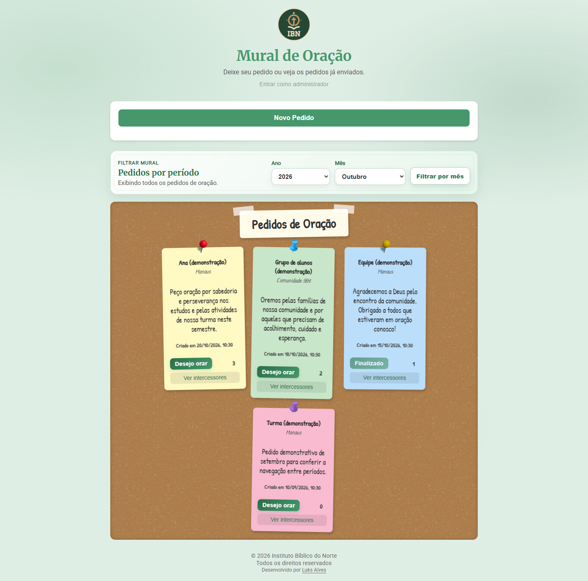
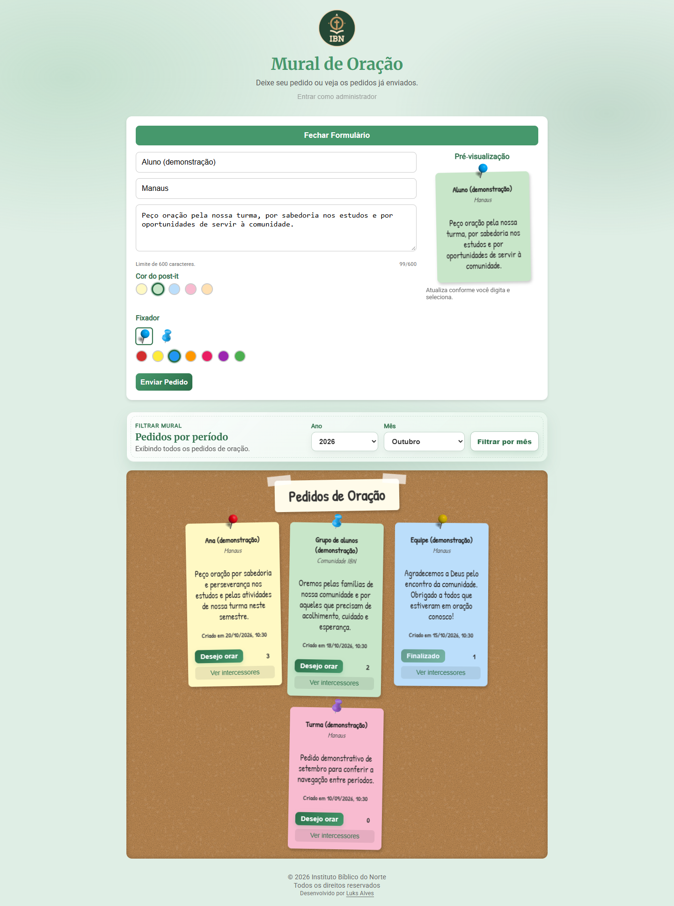
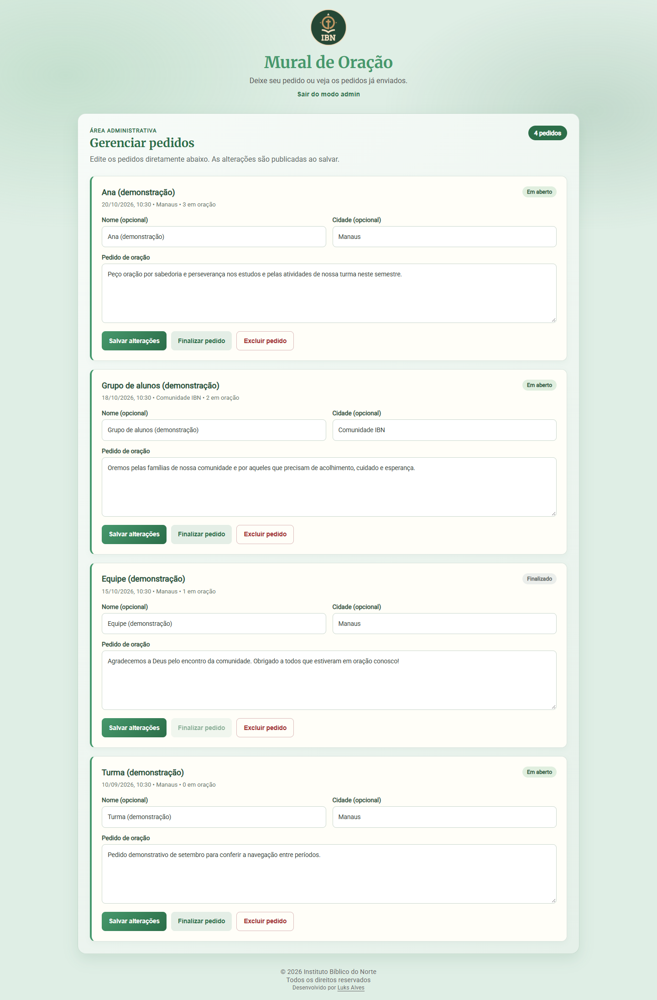

<div align="center">


# Mural de Oração

### Um espaço para compartilhar pedidos e cuidar da comunidade.

Mural interativo para publicar pedidos de oração, registrar intercessões e organizar o acompanhamento pela comunidade do Instituto Bíblico do Norte.


**[Acessar o Mural de Oração](https://muraldeoracao.netlify.app/)** · [Capturas de tela](#capturas-de-tela) · [Executar localmente](#executar-localmente) · [Testes](#testes-e-screenshots) · [Licença](#autor-e-licença)

</div>



## Por que criei o Mural de Oração

No Instituto Bíblico do Norte, onde trabalho, os alunos precisavam de uma ferramenta para organizar os pedidos de oração recebidos e compartilhar pedidos entre si.

Criei o Mural de Oração para reunir essas informações em um espaço acessível: os alunos podem publicar seus próprios pedidos, e pessoas de fora também podem enviar solicitações para que a comunidade esteja orando por elas. Cada pedido aparece no mural com seu texto e sua lista de intercessores. A administração dispõe de uma área própria para manter as informações organizadas.

O projeto parte de uma necessidade real do ambiente de trabalho e combina desenvolvimento web, integração com serviços em nuvem e uma interface inspirada em um mural físico de post-its.

## Funcionalidades

| Perfil | O que pode fazer |
| :--- | :--- |
| Visitantes e alunos | Publicar pedidos, com nome e cidade opcionais, sem criar uma conta. |
| Visitantes e alunos | Escolher entre cinco cores de post-it e dois modelos de fixador em sete cores, com prévia em tempo real. |
| Visitantes e alunos | Visualizar todos os pedidos ao abrir o site e filtrar por ano e mês quando desejarem. |
| Visitantes e alunos | Registrar uma oração com nome ou como anônimo e consultar os intercessores. |
| Administrador | Entrar com e-mail e senha pelo Firebase Authentication e acessar a área de gerenciamento. |
| Administrador | Visualizar todos os pedidos, independentemente do filtro escolhido no mural público. |
| Administrador | Editar nome, cidade e texto de cada pedido e salvar as alterações individualmente. |
| Administrador | Finalizar ou excluir pedidos com confirmação, mantendo pedidos finalizados editáveis. |

O formulário aceita pedidos de até **600 caracteres**. A edição administrativa permite textos de até **2.000 caracteres** e nomes/cidades de até **200 caracteres** nos campos da área administrativa.

O site também oferece rascunho local do texto do pedido, preferências de aparência, avisos de sucesso/erro e **botão de voltar ao topo**, exibido após a rolagem. O retorno ao topo é suave e respeita a preferência por movimento reduzido.

O fluxo público é composto por cadastro de pedidos, registro de oração e consulta de intercessores. O antigo envio de atualizações e seu painel de pendências foram removidos.

## Capturas de tela

Capturas da interface real executada localmente, com nomes, pedidos e intercessores fictícios. A integração Firebase é substituída por dados demonstrativos durante a captura, inclusive para simular a sessão administrativa. Nenhum pedido real é publicado ou alterado para produzir as imagens.

<details>
<summary>Formulário com pré-visualização</summary>



</details>

<details>
<summary>Área administrativa</summary>



</details>

<details>
<summary>Mural no celular</summary>

<p align="center">
  
</p>

</details>

As imagens demonstram a interface; os testes de autorização e as permissões do ambiente de produção dependem das configurações reais do Firebase.

## Como usar

### Visitantes e alunos

1. Abra o site para visualizar todos os pedidos, do mais recente ao mais antigo.
2. Se quiser restringir a lista, selecione o ano e o mês, ou use **Filtrar por mês** para aplicar o período indicado nos campos.
3. Clique em **Mostrar todos** para remover o filtro.
4. Use **Novo Pedido**, escreva o texto, escolha a aparência e confira a prévia antes de enviar.
5. Clique em **Desejo orar** para registrar uma intercessão; o nome é opcional.
6. Abra **Ver intercessores** para consultar a lista e use **Voltar** para retornar à frente do card.
7. Em páginas longas, use a seta no canto inferior direito para voltar ao topo.

Pedidos finalizados permanecem visíveis, mas não aceitam novas intercessões.

### Administração

1. Clique em **Entrar como administrador** e informe as credenciais da conta autorizada.
2. A página passa a exibir a área **Gerenciar pedidos**, com todos os pedidos.
3. Edite nome, cidade e texto nos campos do pedido desejado.
4. Clique em **Salvar alterações** naquele pedido para publicar a edição.
5. Use **Finalizar pedido** ou **Excluir pedido** quando necessário e confirme a ação.
6. Ao sair do modo admin, o site retorna ao mural público, preservando a escolha anterior do filtro.

Edições ainda não salvas são preservadas quando chegam mudanças em tempo real. Esses rascunhos administrativos ficam apenas na memória da página e são limpos ao sair da conta ou recarregar; utilize **Salvar alterações** antes de encerrar a sessão.

## Tecnologias

| Tecnologia | Responsabilidade |
| :--- | :--- |
| HTML5 | Estrutura da página, formulários, filtros, área administrativa e modais. |
| CSS3 | Mural, post-its, animações, responsividade e tema verde. |
| JavaScript | Manipulação do DOM, prévia, navegação, filtros, intercessões e gerenciamento de pedidos. |
| Firebase Authentication | Autenticação administrativa por e-mail e senha. |
| Cloud Firestore | Persistência dos pedidos, transações de intercessão e listeners em tempo real. |
| Firebase compat SDK 9.23.0 | Integração com os serviços Firebase por scripts CDN. |
| localStorage | Rascunho público do texto, preferências e identificador do navegador. |
| Google Fonts | Merriweather, Roboto e Patrick Hand. |
| Netlify | Hospedagem estática, headers de segurança e cache. |
| Python + Playwright + Chrome | Testes de regressão e screenshots com dados fictícios locais. |

HTML, CSS e JavaScript são as linguagens utilizadas no site. Python é usado somente nas ferramentas de teste e captura. A aplicação não exige framework, instalação de dependências ou etapa de build para ser servida.

## Arquitetura e funcionamento

```text
Navegador -> arquivos estáticos publicados no Netlify
    |
    +-> script.js: mural público, filtros, intercessões e autenticação
    +-> admin.js: área administrativa e edição dos pedidos
    +-> localStorage: rascunho público, preferências e identificador
    +-> Firebase Authentication: sessão administrativa
    `-> Cloud Firestore: coleção pedidos
```

`index.html` carrega os SDKs, inicializa o Firebase e disponibiliza o Firestore em `window.db`. `admin.js` é carregado antes de `script.js`, e ambos compartilham as funções necessárias para o gerenciamento.

**Exibição inicial:** o mural carrega todos os pedidos com `createdAt`, ordenados por data decrescente. O usuário decide se deseja aplicar um filtro. Não há paginação nesta versão.

**Consulta mensal:** usa `createdAt >= inícioDoMês` e `createdAt < inícioDoPróximoMês`. O listener anterior é cancelado ao trocar a consulta e respostas antigas são ignoradas. Os anos disponíveis vão de **2025 ao ano atual**; os limites mensais seguem o fuso local do navegador.

**Área administrativa:** a sessão autorizada carrega a lista completa, mesmo que o visitante estivesse usando um filtro mensal. Os editores são reutilizados nas atualizações em tempo real para preservar texto ainda não salvo e foco.

**Intercessões:** uma transação verifica se o pedido existe, se continua aberto e se o identificador local já registrou oração. Cada novo registro acrescenta o nome ao array, preservando pessoas com nomes iguais. O contador utiliza `oracoes`, com fallback para a lista em documentos antigos sem contador válido.

**Ações por ID:** orações, edições, finalização e exclusão usam o ID do documento, evitando trocar o alvo quando a ordenação do mural muda.

**Estados da interface:** carregamento, lista vazia e falha de consulta possuem mensagens distintas. Uma falha oferece a opção de tentar novamente; envios em andamento bloqueiam solicitações duplicadas.

### Dados utilizados

| Coleção | Campos principais |
| :--- | :--- |
| `pedidos` | `nome`, `cidade`, `texto`, `cor`, `pinClass`, `intercessores[]`, `intercessorIds[]`, `oracoes`, `createdAt`, `status`, `attendedAt`. |

O status `finalizado` e o timestamp `attendedAt` são adicionados ao finalizar um pedido. Documentos antigos da coleção `updates` podem permanecer no banco, mas a versão atual não consulta nem grava essa coleção.

### Estrutura

```text
/
|-- index.html
|-- style.css
|-- script.js
|-- admin.js
|-- netlify.toml
|-- firestore.rules
|-- firebase.emulator.json
|-- img/
|-- docs/
|   |-- screenshots/
|   `-- REVIEW.md
|-- scripts/
|   |-- fixtures/mural-demo.js
|   |-- test-regressions.py
|   `-- capture-screenshots.py
|-- tests/firestore/       # Testes das regras no emulador
|-- ASSETS-LICENSE.md
|-- Politica-e-Termos.md
|-- license.txt
|-- license.pt-br.md
`-- README.md
```

Backups e arquivos temporários presentes na pasta de trabalho não são dependências da aplicação. Os padrões excluídos do versionamento estão em `.gitignore`.

## Executar localmente

Use um navegador moderno e um servidor HTTP estático. O exemplo abaixo exige Python 3; não é necessário instalar pacotes para executar o site.

```sh
git clone https://github.com/xLuuks/mural-de-oracao.git
cd mural-de-oracao
python -m http.server 5500 --bind 127.0.0.1
```

Abra [http://127.0.0.1:5500](http://127.0.0.1:5500). A extensão **Live Server** do VS Code também pode ser usada. Evite abrir o HTML diretamente com `file://`.

O Firebase configurado em `index.html` continua sendo utilizado ao executar o site localmente. Para desenvolver sem alterar dados reais, configure um projeto Firebase próprio ou utilize os testes com dados fictícios. O clone exige que sua conta tenha acesso ao repositório.

### Configurar seu próprio Firebase

1. Crie um projeto Firebase e registre um aplicativo web.
2. Substitua `firebaseConfig` em `index.html` pelos valores desse aplicativo.
3. Habilite Cloud Firestore e o provedor E-mail/senha no Authentication.
4. Crie a conta administrativa e configure seu UID em `ADMIN_UID`, em `script.js`.
5. Configure os domínios utilizados no Authentication e teste o login no domínio final.
6. Publique regras que autorizem leitura/cadastro públicos, operações controladas de intercessão e gerenciamento apenas pela conta administrativa.

A verificação de UID no frontend controla a interface. A autorização efetiva depende das regras do Firestore. A proposta em `firestore.rules` valida cadastros, intercessões e alterações administrativas, com testes em `tests/firestore`. Esse arquivo precisa ser publicado separadamente no Firebase; sua presença no repositório não comprova quais regras estão ativas em produção. Consulte o [guia de segurança e testes](docs/FIRESTORE_SECURITY.md).

## Testes e screenshots

Para executar as ferramentas de navegador, use **Python 3**, **Google Chrome** e instale a dependência de teste na pasta local `.tools`:

```sh
python -m pip install --target .tools playwright==1.64.1
```

Execute os testes de regressão:

```sh
python scripts/test-regressions.py
```

A suíte verifica o mural público e a área administrativa, edição e salvamento, preservação de rascunhos em snapshots, finalização, exclusão pelo ID correto, intercessores com nomes iguais, bloqueio de oração em pedidos removidos/finalizados, validação de espaços, prevenção de envio duplicado, recuperação após falhas, filtros e layout mobile. O terminal mostra os grupos concluídos com `PASS:`.

Os testes de navegador substituem o SDK Firebase por uma implementação local e não fazem gravações no banco de produção. Os testes separados em `tests/firestore` verificam as regras no emulador oficial: consulte os [comandos e requisitos](docs/FIRESTORE_SECURITY.md#testar-localmente).

Checagem sintática dos arquivos da aplicação:

```sh
node --check script.js
node --check admin.js
```

Para gerar as capturas utilizadas neste README:

```sh
python scripts/capture-screenshots.py
```

O script inicia um servidor temporário em `127.0.0.1` e salva as imagens em `docs/screenshots`. Google Fonts pode exigir conexão durante a captura. A pasta `.tools` não faz parte das dependências do site ou do versionamento. Ainda não há lint ou CI configurados.

## Deploy no Netlify

| Campo | Configuração |
| :--- | :--- |
| Diretório base | Raiz do projeto. |
| Comando de build | Vazio. |
| Diretório publicado | `.` |
| Configuração | `netlify.toml`. |
| Site | [muraldeoracao.netlify.app](https://muraldeoracao.netlify.app/). |

O deploy deve incluir `index.html`, `style.css`, `script.js`, `admin.js` e os assets utilizados em `img/`. Não há build da aplicação.

`netlify.toml` define CSP, outros headers de segurança, cache de sete dias para imagens/CSS e revalidação para `index.html`, `script.js` e `admin.js`. A URL da folha de estilos é versionada no HTML; novas alterações precisam considerar esse cache.

O Live Server não aplica automaticamente os headers do Netlify. Após publicar, confira o console e a aba Network, o login e os fluxos de leitura/gravação. O modo de integração com GitHub depende da configuração escolhida no painel do Netlify.

## Privacidade e limitações

Pedidos, nomes, cidades e intercessores são exibidos publicamente. A aplicação se conecta ao Firebase para persistência/autenticação e ao Google Fonts para tipografia.

- A prevenção de intercessões repetidas depende do armazenamento local; outro navegador ou a limpeza dos dados cria outra identidade.
- Novos registros preservam nomes iguais, mas nomes perdidos pela deduplicação de versões antigas não podem ser reconstruídos automaticamente.
- Todos os pedidos são carregados inicialmente. Sem paginação, o consumo de dados e o tempo de renderização aumentam conforme o histórico cresce.
- Não há busca textual implementada.
- O rascunho público recupera o texto do pedido; nome e cidade não possuem a mesma recuperação automática.
- Rascunhos administrativos não persistem após logout ou recarregamento.
- Leitura, escrita e login dependem de conexão, disponibilidade e permissões do Firebase.
- Seletores e modais ainda podem receber melhorias de acessibilidade por teclado e gerenciamento de foco.

Consulte a [política e os termos existentes](Politica-e-Termos.md). Esse documento ainda precisa ser alinhado a todos os fluxos atuais.

## Próximos passos

- Manter os testes das regras do Firestore e conferir sua publicação em produção.
- Melhorar acessibilidade dos seletores, modais e faces dos cards.
- Introduzir paginação e busca para históricos maiores.
- Otimizar imagens e ampliar as verificações automatizadas.
- Revisar os documentos de privacidade conforme a evolução do produto.

A [análise técnica de 26/10/2026](docs/REVIEW.md) registra o estado anterior às correções e à reformulação administrativa. É um documento histórico: alguns achados já foram corrigidos e o fluxo de atualizações descrito nele foi descontinuado.

## Autor e licença

Desenvolvido por **[Luks Alves](https://github.com/xLuuks)** para atender uma necessidade da comunidade do **Instituto Bíblico do Norte**.

O código está sob a [licença MIT](license.txt), com copyright do Instituto Bíblico do Norte conforme o arquivo existente. A [tradução em português](license.pt-br.md) é informativa.

A marca do IBN e os assets gráficos possuem condições próprias de uso. Consulte [ASSETS-LICENSE.md](ASSETS-LICENSE.md); a licença do código não concede automaticamente direitos de reutilização da marca ou redistribuição isolada dos assets.
