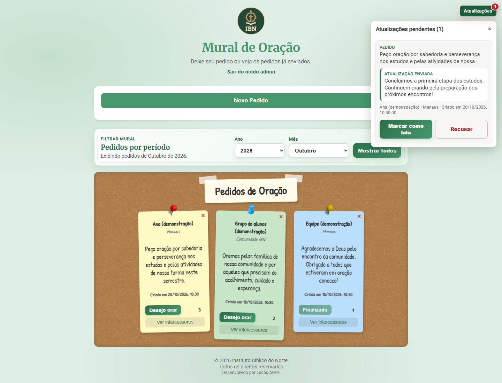

<div align="center">


# Mural de Oração

### Um espaço para compartilhar pedidos e cuidar da comunidade.

Mural interativo para organizar pedidos de oração, registrar intercessões e acompanhar atualizações em tempo real.


**[Acessar o Mural de Oração](https://muraldeoracao.netlify.app/)** · [Capturas de tela](#capturas-de-tela) · [Executar localmente](#executar-localmente) · [Licença](#autor-e-licença)

</div>


## Por que criei o Mural de Oração

No Instituto Bíblico do Norte, onde trabalho, os alunos precisavam de uma ferramenta para organizar os pedidos de oração recebidos e compartilhar pedidos entre si.

Criei o Mural de Oração para reunir essas informações em um espaço acessível: os alunos podem publicar seus próprios pedidos, e pessoas de fora também podem enviar solicitações para que a comunidade esteja orando por elas. O mural dá visibilidade aos pedidos e permite acompanhar quem registrou uma intercessão e quais informações novas foram enviadas ao administrador.

O projeto combina uma necessidade real do ambiente de trabalho com desenvolvimento web, integração com serviços em nuvem e uma interface inspirada em um mural físico de post-its.

## Funcionalidades

| Perfil | O que pode fazer |
| :--- | :--- |
| Visitantes e alunos | Publicar pedidos com nome e cidade opcionais, sem criar uma conta. |
| Visitantes e alunos | Escolher entre cinco cores de post-it e dois modelos de fixador em sete cores, com prévia ao digitar. |
| Visitantes e alunos | Filtrar por ano e mês ou usar **Mostrar todos** para consultar o histórico. |
| Visitantes e alunos | Registrar uma oração com nome ou como anônimo e consultar a lista de intercessores. |
| Visitantes e alunos | Enviar uma atualização de um pedido para revisão administrativa. |
| Administrador | Entrar com e-mail e senha pelo Firebase Authentication. |
| Administrador | Editar o texto, finalizar e excluir pedidos. |
| Administrador | Ver o indicador de pendências e marcar atualizações como lidas ou recusadas. |

A interface oferece rascunho local do texto do pedido, preferências de aparência, notificações de ações, confirmações de descarte e layout adaptado para celular. O cadastro aceita até **600 caracteres**; atualizações, até **800**; a edição administrativa, até **2.000**.

**Marcar como lida não publica a atualização no pedido.** Essa ação altera o status da mensagem na fila administrativa. A edição do pedido continua sendo uma operação separada.

## Capturas de tela

Capturas da interface real executada localmente, com nomes, pedidos e mensagens fictícios. A integração Firebase foi substituída por uma fixture durante a captura, inclusive para simular a interface administrativa. Nenhum pedido real foi cadastrado ou alterado para produzir estas imagens. As capturas ilustram o layout e os fluxos; não comprovam permissões ou operações no ambiente de produção.

<details>
<summary>Formulário com pré-visualização</summary>


</details>

<details>
<summary>Painel administrativo de atualizações</summary>



</details>

<details>
<summary>Mural no celular</summary>

<p align="center">
  
</p>

</details>

## Como usar

1. Acesse o site e selecione o ano e o mês dos pedidos. O período inicial é o mês atual do navegador.
2. Use **Mostrar todos** para consultar o histórico completo e **Voltar ao mês** para reaplicar o período anterior.
3. Clique em **Novo Pedido**, escreva o texto e confira a prévia antes de enviar.
4. Use **Desejo orar** em um pedido para registrar uma intercessão.
5. Abra **Ver intercessores** para consultar os nomes e acessar o envio de atualizações.
6. Para gerenciar o mural, use **Entrar como administrador** com a conta autorizada.

Pedidos finalizados continuam visíveis, com o registro de novas orações desabilitado na interface.

## Tecnologias

| Tecnologia | Uso no projeto |
| :--- | :--- |
| HTML5 | Estrutura da página, formulários, filtros e modais. |
| CSS3 | Mural, post-its, animações, responsividade e tema verde. |
| JavaScript | Manipulação do DOM, prévia, filtros e fluxos de visitantes e administração. |
| Firebase Authentication | Autenticação administrativa por e-mail e senha. |
| Cloud Firestore | Persistência de pedidos e atualizações, consultas e listeners em tempo real. |
| Firebase compat SDK 9.23.0 | Integração com os serviços Firebase por scripts CDN. |
| localStorage | Rascunho do texto, preferências e identificador local do navegador. |
| Google Fonts | Merriweather, Roboto e Patrick Hand. |
| Netlify | Hospedagem estática, headers de segurança e cache. |

O site não utiliza framework de interface, gerenciador de pacotes ou etapa de build. As ferramentas de screenshots são opcionais e separadas da execução do site.

## Arquitetura e funcionamento

```text
Navegador -> HTML + CSS + JavaScript publicados no Netlify
    |
    +-> localStorage: rascunho, preferências e identificador local
    +-> Firebase Auth: sessão administrativa
    `-> Cloud Firestore
         +-> pedidos: mural, intercessões e finalização
         `-> updates: mensagens para revisão administrativa
```

`script.js` concentra a interface e a integração Firebase. `index.html` carrega os SDKs, inicializa o app e expõe o Firestore como `window.db`.

**Consulta por período:** o listener usa `createdAt >= inícioDoMês` e `createdAt < inícioDoPróximoMês`, ordenados do mais recente ao mais antigo. Ao trocar o período, o listener anterior de pedidos é cancelado. Os anos oferecidos vão de **2025 ao ano atual**. Os limites mensais seguem o fuso local do navegador.

**Histórico completo:** Mostrar todos remove o intervalo mensal e mantém a ordenação por data. Essa modalidade ainda não possui paginação.

**Intercessões:** o cliente executa uma transação com `intercessores`, `intercessorIds` e `oracoes`. O identificador é local ao navegador e não representa uma conta autenticada do visitante.

**Administração:** o frontend compara o UID autenticado com `ADMIN_UID`. A autorização de acesso aos dados depende das regras do Firestore; ocultar botões não protege o banco.

### Dados utilizados

| Coleção | Campos principais |
| :--- | :--- |
| `pedidos` | `nome`, `cidade`, `texto`, `cor`, `pinClass`, `intercessores[]`, `intercessorIds[]`, `oracoes`, `createdAt`, `status`, `attendedAt`. |
| `updates` | `pedidoId`, `message`, `status`, `createdAt`, `submittedBy`, `pedidoCreatedAt`, `pedidoResumo`, `pedidoNome`, `pedidoCidade`. |

O status `finalizado` e o timestamp `attendedAt` são adicionados ao finalizar um pedido. Atualizações usam `pending`, `reviewed` e `rejected`. O resumo do pedido salvo em uma atualização contém até 80 caracteres.

### Estrutura

```text
/
|-- index.html
|-- style.css
|-- script.js
|-- netlify.toml
|-- img/
|-- docs/
|   |-- screenshots/
|   `-- REVIEW.md
|-- scripts/
|   |-- fixtures/mural-demo.js
|   `-- capture-screenshots.py
|-- ASSETS-LICENSE.md
|-- Politica-e-Termos.md
|-- license.txt
|-- license.pt-br.md
`-- readme.md
```

Backups e arquivos temporários presentes na pasta de trabalho não são dependências do site. Consulte os nomes excluídos em `.gitignore`.

## Executar localmente

É necessário um navegador moderno e um servidor HTTP estático. Para usar o exemplo abaixo, instale Python 3. Não é necessário instalar pacotes para executar o site.

```sh
git clone https://github.com/xLuuks/mural-de-oracao.git
cd mural-de-oracao
python -m http.server 5500 --bind 127.0.0.1
```

Abra [http://127.0.0.1:5500](http://127.0.0.1:5500). A extensão Live Server do VS Code também atende a esse uso. Evite abrir o HTML diretamente com `file://`.

**O projeto aponta para um Firebase existente.** Executar em localhost não isola o banco: ações permitidas pelas regras podem gravar dados reais. Configure seu próprio projeto Firebase para desenvolver com persistência. O repositório precisa estar acessível à sua conta para o clone funcionar.

### Configurar seu próprio Firebase

1. Crie um projeto Firebase e registre um aplicativo web.
2. Substitua `firebaseConfig` em `index.html` pelos valores desse aplicativo.
3. Habilite Cloud Firestore e o provedor E-mail/senha no Authentication.
4. Crie a conta administrativa e configure o UID em `ADMIN_UID`, em `script.js`.
5. Configure os domínios utilizados no Authentication e teste o login no domínio final.
6. Publique e teste regras do Firestore compatíveis com os fluxos públicos e administrativos.

As regras publicadas, índices e configurações do console Firebase **não estão versionados nesta pasta**. Não há garantia de segurança baseada apenas no código do cliente. As regras devem validar campos, tipos, tamanhos e alterações permitidas; limitar operações de intercessão; e proteger a fila administrativa. Não use leitura ou escrita irrestritas como solução para erros de permissão.

## Verificações e screenshots

Checagem sintática do JavaScript:

```sh
node --check script.js
```

O projeto ainda não possui suíte completa de testes, lint ou CI. O script de captura exercita filtros, histórico completo, estado vazio e indicador de pendências com dados locais; também registra reproduções de bugs identificados na análise.

Para reproduzir as capturas, use Python 3 e Google Chrome instalado:

```sh
python -m pip install --target .tools playwright==1.64.1
python scripts/capture-screenshots.py
```

O script inicia um servidor temporário em `127.0.0.1`, intercepta os SDKs Firebase e gera as imagens em `docs/screenshots`. Google Fonts pode exigir internet. A pasta `.tools` não faz parte do site ou do versionamento.

## Deploy no Netlify

| Campo | Configuração |
| :--- | :--- |
| Diretório base | Raiz do projeto. |
| Comando de build | Vazio. |
| Diretório publicado | `.` |
| Configuração | `netlify.toml`. |
| Site | [muraldeoracao.netlify.app](https://muraldeoracao.netlify.app/). |

O arquivo define CSP e outros headers de segurança, cache de sete dias para imagens/CSS e revalidação para `index.html` e `script.js`. Alterações de CSS podem exigir invalidação do cache ou versionamento da URL. O Live Server não aplica automaticamente os headers do Netlify; confira o console e a aba Network depois de publicar.

O modo de deploy escolhido no painel do Netlify deve ser conferido separadamente. A presença de `netlify.toml` não comprova integração automática com uma branch do GitHub.

## Privacidade e limitações

Pedidos, nomes, cidades e listas de intercessores são exibidos publicamente no mural. O texto e as informações enviados devem considerar essa exposição. O navegador se conecta ao Firebase para persistência/autenticação e ao Google Fonts para tipografia.

- A prevenção de intercessões repetidas depende do armazenamento local; outro navegador ou a limpeza dos dados cria outra identidade.
- Nomes iguais podem ser deduplicados na lista atual de intercessores. O relatório técnico descreve essa limitação.
- Não há busca textual, paginação ou histórico público de atualizações implementados.
- O conteúdo do pedido é salvo como rascunho local; nome e cidade não possuem a mesma recuperação automática.
- Leitura, escrita e login dependem de conexão, disponibilidade e regras do Firebase.
- Os seletores e modais ainda precisam de melhorias adicionais de navegação por teclado e foco.

Veja a [política e os termos existentes](Politica-e-Termos.md). Esse documento também precisa ser revisado para refletir todos os fluxos atuais.

## Próximos passos

- Substituir posições de lista por IDs estáveis nas ações de oração e exclusão.
- Vincular a assinatura de atualizações ao estado de autenticação administrativa.
- Rever o modelo de intercessões para preservar pessoas com nomes iguais.
- Versionar regras e testes de autorização do Firestore em ambiente isolado.
- Adicionar estados de carregamento/erro, paginação e melhorias de acessibilidade.
- Otimizar imagens e separar responsabilidades do JavaScript.

Esses itens são melhorias propostas, não funcionalidades já entregues. A análise detalhada, evidências e prioridades estão em [docs/REVIEW.md](docs/REVIEW.md).

## Autor e licença

Desenvolvido por **[Lucas Alves](https://github.com/xLuuks)** para atender uma necessidade da comunidade do **Instituto Bíblico do Norte**.

O código está sob a [licença MIT](license.txt), com copyright do Instituto Bíblico do Norte conforme o arquivo existente. A [tradução em português](license.pt-br.md) é informativa.

A marca do IBN e os assets gráficos possuem condições próprias de uso. Consulte [ASSETS-LICENSE.md](ASSETS-LICENSE.md); a licença do código não concede automaticamente direitos de reutilização da marca ou redistribuição isolada dos assets.
